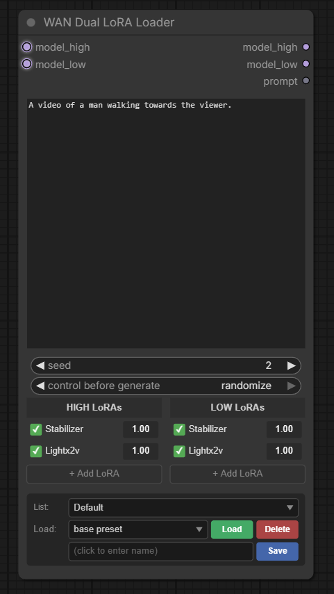

# Hermes Nodes

Custom nodes for ComfyUI: WAN 2.2 dual-model (HIGH/LOW noise) LoRA loading and sampling,
image prep helpers, and in-graph video preview/compare.

Feature requests and bug reports are welcome - please open an issue on GitHub.

## Installation

- **ComfyUI Manager / Registry:** search for "Hermes Nodes".
- **Manual:** clone into `ComfyUI/custom_nodes` and restart ComfyUI:
  ```
  git clone https://github.com/Lannister34/ComfyUI-HermesNodes custom_nodes/hermes-nodes
  ```

No extra Python dependencies - everything used ships with ComfyUI.

## Nodes

| Node | Category | What it does |
|------|----------|--------------|
| WAN Dual LoRA Loader | `loaders/wan` | Separate LoRA stacks for the HIGH and LOW models, presets, wildcard prompt |
| WAN Dual KSampler | `sampling` | HIGH model for the first `switch_step` steps, LOW model for the rest; separate CFG per phase |
| WAN Dual KSampler (Boundary) | `sampling` | Same, but switches where the timestep crosses `boundary` (0.875 T2V / 0.9 I2V) |
| Image Scale To | `hermes/image` | Scale so the shorter/longer side hits a size, keep aspect, snap to a multiple (e.g. 16) |
| Pad Image to Square | `hermes/image` | Scale longest side to `size` and center on a square canvas of a fill color |
| Random Image Loader | `hermes/image` | Seeded random image from a folder, with a folder picker and in-node preview |
| Video Preview | `hermes/video` | Encode frames (+ audio) to mp4 and play in the node: autoplay, sound on hover, click to pause |
| Video Player | `hermes/video` | Same encoding, native player controls for scrubbing |
| Video Compare (Side-by-Side) | `hermes/video` | Tile up to 6 videos into one grid clip for A/B comparisons |

Node ids (for API-format workflows): `WANDualLoraLoader`, `WANDualKSampler`, `WANDualKSamplerBeta`,
and `Hermes` + the node name for the rest (`HermesImageResize`, `HermesVideoPreview`, ...).

Video nodes save to `temp/` by default (preview only); enable `save_output` to write to `output/`.
Saved mp4 files embed the workflow, so they can be dragged back into ComfyUI.

### WAN Dual LoRA Loader



LoRAs are read from a dedicated folder tree (created on first start):

```
models/loras/wan/
├── I2V/          <- LoRAs here appear in both HIGH and LOW lists
│   ├── HIGH/
│   └── LOW/
└── T2V/
    ├── HIGH/
    └── LOW/
```

- **Auto-match** - adding `x_HIGH` to one column also adds its `x_LOW` twin to the other
- **Presets** - save/load prompt + both LoRA stacks, grouped into lists
  (stored in `ComfyUI/user/hermes_presets/wan_lora_presets.json`)
- **Wildcards** in the prompt:
  - `{option1|option2|option3}` - random choice
  - `__filename__` - random line from `ComfyUI/user/wildcards/filename.txt`
  - `<random:0.5:1.0>` - random float in range

Outputs: `model_high`, `model_low`, `prompt` (wildcards resolved).

## License

MIT
